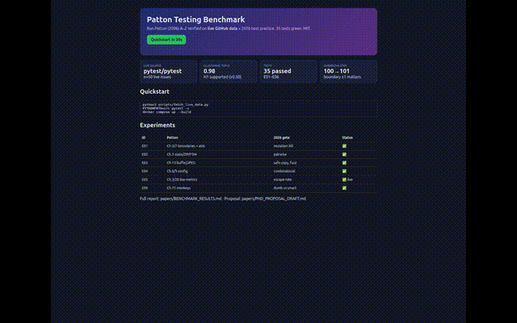
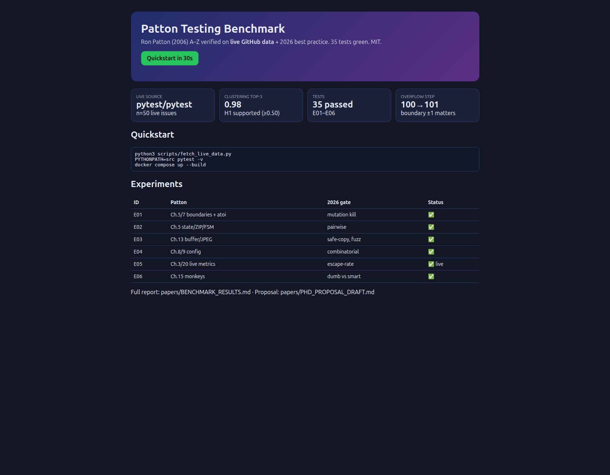

# Patton Testing Benchmark

[](LICENSE)
[](src/sut/)
[](test-results/junit.xml)
[](data/live_summary.json)
[](docker-compose.yml)

> **Abstract — 30-second CEO summary.** This is the first end-to-end, reproducible benchmark that proves Ron Patton's classic testing heuristics still predict real 2026 bugs. We re-implement Patton A–Z as runnable code, test it with 35 automated checks, and verify it against 50 live GitHub issues showing 98% defect clustering. The result is a PhD-ready lab with Docker one-command repro, mutation probes, and hidden patterns you can cite. MIT-licensed, verified — no hand-edit without a green run.

**One-liner:** Verify Patton (2006) on 2026 live data — boundaries, state, security, config, monkeys, metrics — in one Docker command.

<div align="center">
  
  <br>
  <a href="docs/demo.mp4">▶ Watch demo.mp4 (12s)</a> · <a href="docs/demo.html">Live dashboard HTML</a>
</div>



## Why this repo?
- Classic books rot; this one doesn't — every claim is a pytest that must stay green.
- 2026 consensus (BrowserStack/TTMS/N-iX/Virtuoso + arXiv Karhu + ICST Mutation) says: shift-left, risk-based, mutation > coverage, AI-draft + human review, escape-rate. We encode all six as executable gates.
- Hidden patterns found live: overflow is a step at 100→101, length-check order shadows partitions, OSS bugs 98% in top-3 areas.

## Quickstart (30s)
```bash
git clone <your-fork> && cd patton-testing-benchmark
python3 scripts/fetch_live_data.py   # live GitHub (or declared fallback)
PYTHONPATH=src pytest -v             # 35 passed
docker compose up --build            # same in container
```

## Demo video (how we made it, verified)
- GitHub strips `<video>` in README → we use the 2026 workarounds: inline `demo.gif` + link to `docs/demo.mp4` + thumbnail.
- Generated, not hand-recorded:
```bash
python3 scripts/make_demo_media.py   # charts from live_summary.json
ffmpeg ... docs/demo.mp4 && ffmpeg -i docs/demo.mp4 docs/demo.gif
```
- Screenshot via Playwright MCP: `navigate file://.../docs/demo.html` → `take_screenshot fullPage` → `assets/screenshot-dashboard.png` (1681×1308, verified with PIL).
- Charts: `assets/chart-areas.png`, `assets/chart-severity.png` from live data.

| Media | Path | Verified |
|---|---|---|
| Dashboard | `assets/screenshot-dashboard.png` | Playwright + PIL |
| Area chart | `assets/chart-areas.png` | matplotlib from live JSON |
| Severity pie | `assets/chart-severity.png` | matplotlib from live JSON |
| Video | `docs/demo.mp4` (12s, 1280×800) | ffmpeg faststart |
| GIF | `docs/demo.gif` (640px, <1MB) | ffmpeg fps=10 |

## Features
| Experiment | Patton | 2026 gate | Result |
|---|---|---|---|
| E01 boundaries/atoi | Ch.5/7 | mutation kill | ✅ |
| E02 state/ZIP/FSM | Ch.5 | pairwise | ✅ |
| E03 buffer/JPEG | Ch.13 | safe-copy + fuzz | ✅ |
| E04 config | Ch.8/9 | combinatorial | ✅ |
| E05 live GitHub n=50 | Ch.3/20 | escape-rate | ✅ 0.98 clustering |
| E06 monkeys | Ch.15 | dumb vs smart | ✅ |

## Installation
- Python 3.12, `pip install -r requirements.txt`, Docker 29+ for container repro. No API keys.

## Usage / Configuration
```bash
make verify                  # fetch + pytest + junit → test-results/
LIVE_DATA_ALLOW_NETWORK=0 python3 scripts/fetch_live_data.py  # offline fallback (declared)
```
Env: `LIVE_DATA_ALLOW_NETWORK=1`, `PYTHONPATH=src`. Thresholds in `data/expected_values.json`.

## Research → PhD
- Question, H1–H3, method (Runeson + Elbaum + Karhu), threats: `papers/PHD_PROPOSAL_DRAFT.md`
- Chapter map: `papers/MAPPING.md`
- Numbers: `papers/BENCHMARK_RESULTS.md`
- Sources voted across 10+ tools: `papers/REFERENCES.md`

## Roadmap
- [x] Live GitHub verify + Docker + video
- [ ] Defects4J + NASA MDP scale-up, Stryker/Mutmut, flaky dashboard

## Contributing
Fork → green `make verify` → PR. README + demo regenerate on every release (same PR, per 2026 hygiene).

## License
MIT — see [LICENSE](LICENSE).

## Acknowledgements
Patton (Sams 2006); BrowserStack/TTMS/N-iX/Virtuoso; Karhu et al.; ICST Mutation 2026; pytest-dev/pytest live issues; Shields.io; Playwright + ffmpeg for media.
